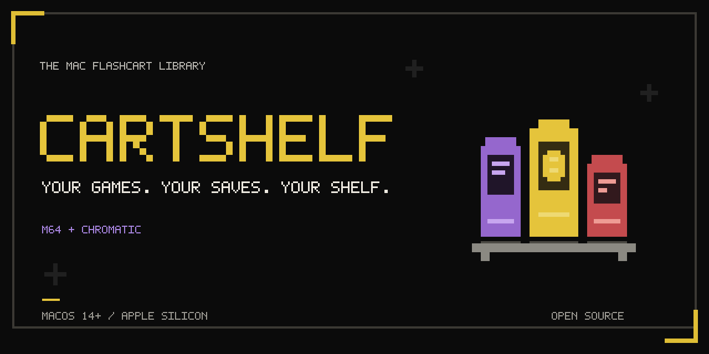
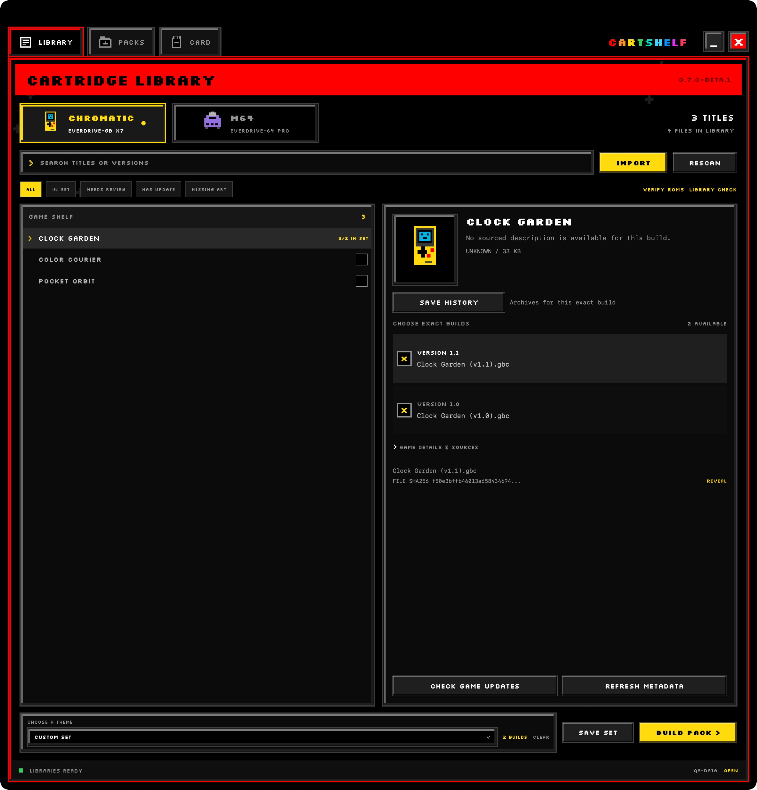
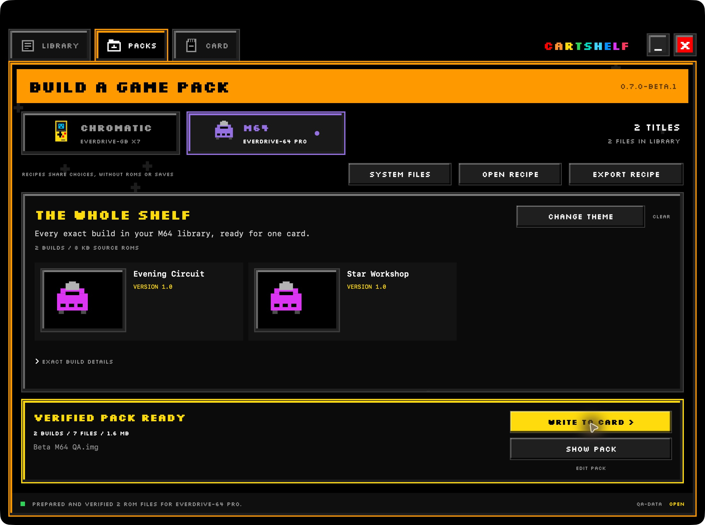
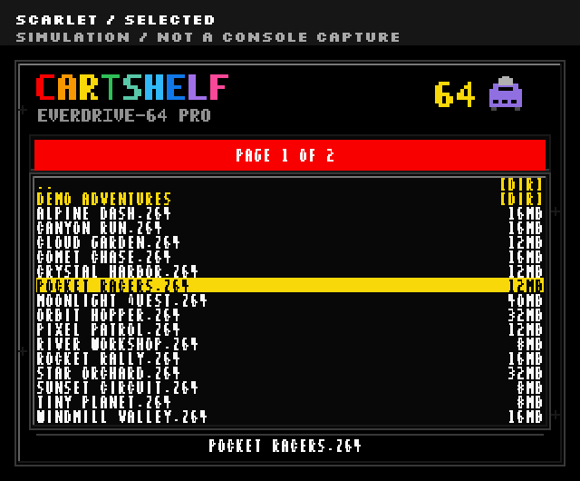

# CartShelf

A native Mac app for your ModRetro game collection. Browse exact ROM builds, make themed packs, and prepare EverDrive SD cards with verified backups and save history.

**[Download the Mac beta](https://github.com/steph4n-gh/CartShelf/releases/tag/v0.7.0-beta.2)** · [Get started](docs/getting-started.md) · [Browse the guides](docs/README.md) · [Report a bug](https://github.com/steph4n-gh/CartShelf/issues/new/choose)

[](https://github.com/steph4n-gh/CartShelf/actions/workflows/checks.yml)

**macOS 14 or later. Apple Silicon.** The packaged beta includes its Python runtime. You do not need Homebrew or a separate Python installation.



The app screenshots use fictional titles and generated, nonplayable game and save fixtures. They contain no personal collection or save data. Theme previews are labelled simulations.

## Two device pairs

| Console | Cartridge |
| --- | --- |
| ModRetro M64 | EverDrive-64 PRO |
| ModRetro Chromatic | EverDrive-GB X7 |

Bring your own game files and obtain cartridge system files from the manufacturer. The repository and app contain no ROM collection, save files, or vendor firmware.

## Know what is on your shelf

Browse titles and choose exact builds. Refresh descriptions and artwork, inspect their sources, and filter for missing art or files that need review. **VERIFY ROMS** separates reference matches from unlisted builds and structural problems. **LIBRARY CHECK** previews confirmed duplicates before moving extra copies into recoverable quarantine.

On the Chromatic shelf, check public ModRetro game release notes for newer listed versions. The filename comparison does not patch games or prove save compatibility. [Manage your library](docs/library.md).

## Make a pack for tonight

Save a puzzle afternoon, a racing night, or your own discovery set. Preview the exact games, then build a folder, ZIP, or compact FAT32 image. Direct installation through CartShelf uses the card's full capacity.

**CHOOSE A THEME** and **CHANGE THEME** select a saved game set. **ARCHIVE SET** retires a saved set without deleting its ROMs.



**VERIFIED PACK READY** takes the image into the Card workflow. Share the same choices as an exact-hash recipe without including game files, saves, firmware, or local paths. Missing recipe builds stay missing. [Build packs and share recipes](docs/packs-and-recipes.md).

## Keep your progress between packs

Review games added, retained, and removed alongside each save's source. CartShelf verifies a backup before replacing the card and restores safely matched progress. Saves without a safe match remain in the backup.

The save timeline lets you verify or export a complete earlier bundle and choose it for one reviewed write. SRAM and clock files stay together. Both routine file backups and whole-card recovery have their own review. [See the save timeline and recovery steps](docs/backup-and-recovery.md).

## Match the cartridge menu



Authored simulation, not a console capture. M64 packs include the CartShelf-64 artwork and font. Chromatic packs use the matching charcoal, white, scarlet, and yellow palette on the supported X7 menu OS. [See both themes](docs/themes.md), their scope, and the source builders. The public N64 font atlas still needs a physical test.

## Keep system files accounted for

**SYSTEM FILES** shows the supported import version, required checksum, official download, and cache status. Card review shows the system files in the prepared pack. M64 metadata refresh also checks for a newer official EFU and caches it for packs.

Installed cartridge firmware remains unknown. An EFU is an updater you run on the cartridge when needed. Copying it to a card does not flash it. The X7 menu OS loads from the card. [Prepare system files and understand firmware tracking](docs/system-files.md).

## Start with your own library

1. Download the beta ZIP and move `CartShelf.app` to Applications or another normal mounted drive.
2. Open CartShelf and create or connect a writable library folder outside the app and source checkout.
3. Import your games, then open **PACKS > SYSTEM FILES** to import and verify the manufacturer's supported files.
4. Select exact builds in **LIBRARY**, then open **PACKS** to build an image.
5. Follow [the first card-write guide](docs/getting-started.md#write-a-spare-card) with a spare card and a verified backup.

Your library folder holds games, downloaded metadata, system files, packs, backups, and browsing preferences. It can live on an external drive. CartShelf reconnects to that folder when you reopen the app.

## Beta status

Version `0.7.0-beta.2` is Developer ID signed and notarized. This release fixes issues found while testing `0.7.0-beta.1` from an empty library. That app-only walkthrough covered both device profiles, imports, system files, recipes, duplicate recovery, and all three pack outputs. Independent checks mounted both beta1 exported images read-only and matched their files to the prepared manifests. See the [release notes](https://github.com/steph4n-gh/CartShelf/releases/tag/v0.7.0-beta.2) for qualification details.

Clean external-Mac testing and physical SD-card tests of this rebuilt beta remain open. Those checks include card recovery, clock and save persistence, native card-operation contention, and the public N64 font atlas. Earlier private-build hardware results do not qualify this beta. Use [the beta checklist](docs/beta-testing.md) to record a result.

## Build from source

Build on macOS with Python 3.13 or later and the Xcode command-line tools.

```sh
python3 -m venv .venv
.venv/bin/python -m pip install -r requirements-dev.txt
.venv/bin/python -B -m unittest discover -s tests
.venv/bin/python tools/check_publication.py
.venv/bin/python app/build.py
```

The output is `dist/CartShelf.app`. A default local build has an ad-hoc signature. [Build and release instructions](docs/build-and-release.md) cover distribution signing, notarization, and source checks.

## Read more or contribute

- [Choose a guide by task](docs/README.md).
- [Browse, verify, and clean up your library](docs/library.md).
- [Build packs and share recipes](docs/packs-and-recipes.md).
- [See the cartridge menu themes](docs/themes.md).
- [Back up and recover a card](docs/backup-and-recovery.md).
- [Prepare cartridge system files](docs/system-files.md).
- [Understand the code and data boundaries](docs/architecture.md).
- [Read the changelog](CHANGELOG.md).
- [Contribute a change](CONTRIBUTING.md) and follow the [community guidelines](CODE_OF_CONDUCT.md).
- [Report a security problem privately](SECURITY.md).

CartShelf source is GPL-3.0-only. Fonts retain their OFL license. See [LICENSE](LICENSE), [third-party notices](THIRD_PARTY_NOTICES.md), and [image provenance](docs/images/README.md).

CartShelf is an independent project. Console and cartridge names identify compatibility targets.
