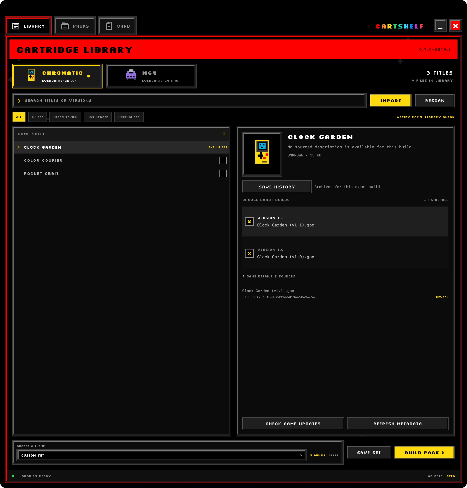

# CartShelf guides

Start with [your first pack](getting-started.md). You will connect a library, import games, prepare system files, and review a spare-card write.

The screenshots use fictional titles and generated, nonplayable game and save data. Theme previews are labelled simulations or palette references. See [image provenance](images/README.md).

## Choose a task

| You want to | Open |
| --- | --- |
| Browse versions, refresh artwork, check ROMs, or clean up duplicates | [Manage your library](library.md) |
| Make a themed set, choose an export, or share exact-build choices | [Build packs and share recipes](packs-and-recipes.md) |
| See the matching M64 and Chromatic menus | [CartShelf themes](themes.md) |
| Check supported system files and the updater included in a pack | [System files and firmware](system-files.md) |
| Keep progress, choose an older save, or recover a card | [Backups and save recovery](backup-and-recovery.md) |
| Help qualify the Mac beta | [Beta testing](beta-testing.md) |

## Work on CartShelf

Read [the code and data boundaries](architecture.md), [build a local app](build-and-release.md), or [contribute a change](../CONTRIBUTING.md). The [project README](../README.md) has the download, platform requirements, and beta status.
