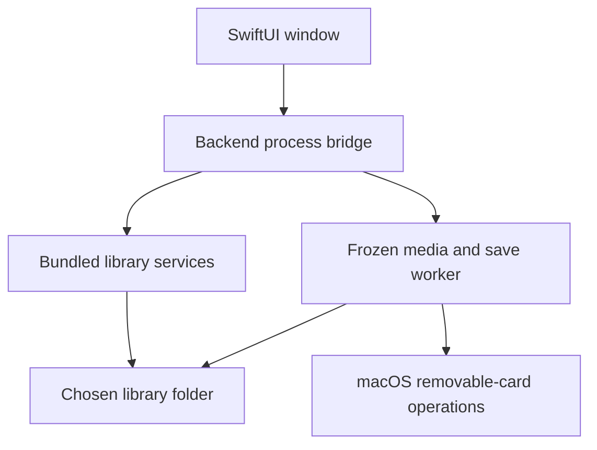

# Code and data boundaries

CartShelf has a SwiftUI window, bundled Python services, and a separately chosen library folder. The source supports two concrete console and cartridge pairs. Each pair has rules for ROM identity, filenames, saves, system files, and themes.

## Source ownership

| File | Responsibility |
| --- | --- |
| [`app/CartShelf.swift`](../app/CartShelf.swift) | Native browser, pack builder, card review, preferences, library connection, and process bridge. |
| [`library_manager.py`](../library_manager.py) | Library scans, imports, exact builds, collections, recoverable duplicate cleanup, and pack preparation. |
| [`library_experience.py`](../library_experience.py) | Recipe inspection and import, save-history inspection and export, card labels, and operation history. |
| [`recipes.py`](../recipes.py) | Bounded recipe format and exact-build resolution. |
| [`card_saves.py`](../card_saves.py) | Save bundles, content identities, verified history, and restore matching. |
| [`media.py`](../media.py) | Card admission, write plans, backups, FAT32 installation, recovery, readback, and ejection. |
| [`prepared_images.py`](../prepared_images.py) | Prepared-image discovery and verification. |
| [`system_files.py`](../system_files.py) | Supported official file identities and verified offline import. |
| [`rom_verifier.py`](../rom_verifier.py) | ROM integrity and reference-data checks. |
| [`handheld_metadata.py`](../handheld_metadata.py), [`prepare_everdrive64.py`](../prepare_everdrive64.py), and [`cart_updates.py`](../cart_updates.py) | Device-specific metadata, N64 preparation support, and known game-update data. |
| [`app/build.py`](../app/build.py), [`app/runtime.py`](../app/runtime.py), and [`app/media_bundle.py`](../app/media_bundle.py) | App packaging, pinned runtime preparation, and the frozen media worker. |
| [`tools/check_publication.py`](../tools/check_publication.py) | Source, Git history, archives, app resources, runtime inventories, and notarization-ticket checks. |

## Library identity

The native connection records the selected folder's volume and directory identity. The Python library also checks its device and inode. Replacing or disconnecting the folder invalidates the connection. A later operation must reconnect rather than silently create a new library elsewhere.

The library stores imported games, catalogs, collections, metadata and system-file caches, exports, backups, history, and browsing preferences. It stays outside the app and source checkout. The app executes its bundled services rather than scripts found in that folder.

## Process execution

The packaged app includes a pinned Python runtime and core modules. The native bridge launches them with isolated imports and bytecode writes disabled. The media worker freezes `media.py` and `card_saves.py` together so a replacement operation uses the reviewed save matcher.

## Reviewed card replacement

A plan binds the live card identity, image identity, library identity, backup method, save choices, and preview to the reviewed write. Installation takes an operation lock, validates the plan again, and verifies the backup before formatting.

Matching uses exact ROM content identity, including N64 byte-order normalization. A selected earlier save names a verified whole bundle and applies to one write. SRAM and clock members stay together. Files without a safe automatic match remain in the verified backup.

Successful write receipts and console checks answer separate questions. The [beta checklist](beta-testing.md) keeps native app behavior, virtual media, physical cards, console boot, and save persistence separate.

## Publication boundary

`source-manifest.json` lists reviewed source and assets. Binary assets have exact hashes and notices. The publication check inspects the worktree, index, reachable Git history, source archives, and packaged content. Build output and library data are separate from public source.

A new device requires demonstrated filesystem and save rules plus physical qualification. [Contributing guidance](../CONTRIBUTING.md#add-a-device) describes the evidence needed before adding compatibility claims.
