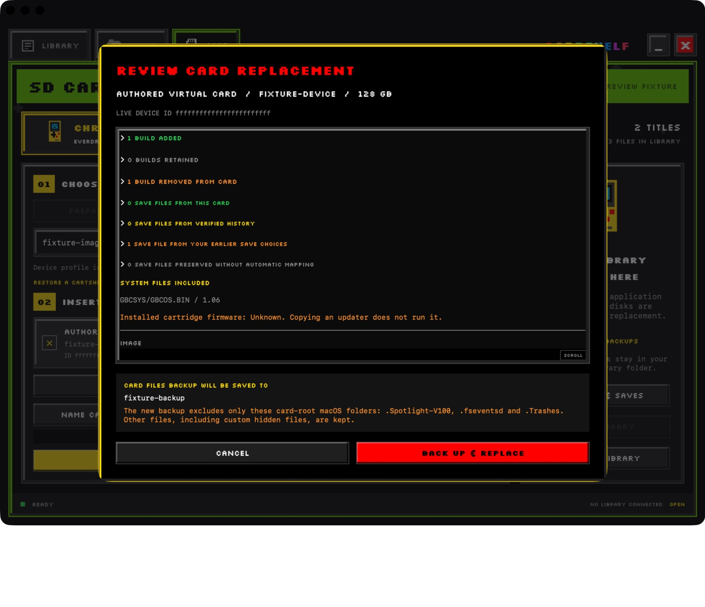
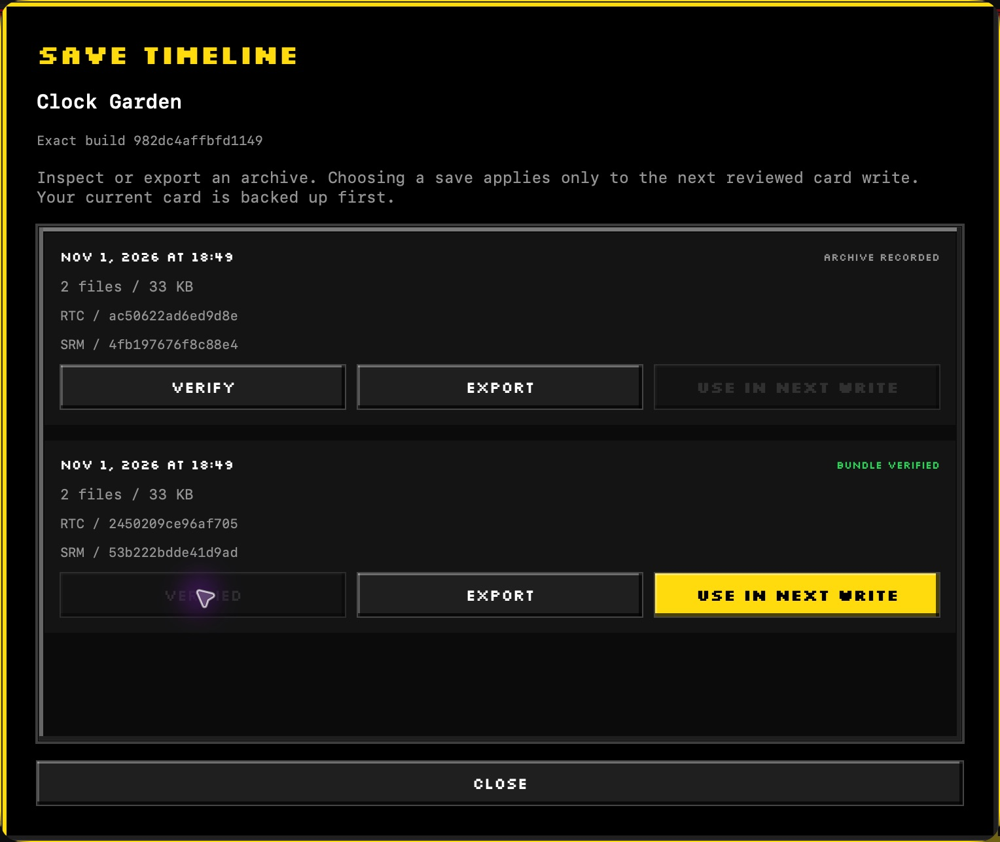

# Back up and recover a card

Finish saving in your game, allow card activity to complete, and power off before removing the SD card. CartShelf preserves bytes already written to SD.

## Choose a backup

| Method | What it preserves | When to use it |
| --- | --- | --- |
| **CARD FILES** | Game files, saves, system files, settings, custom hidden files, and empty directories. | Routine pack changes and supported file recovery. |
| **WHOLE CARD IMAGE** | Every sector, including unused capacity, the partition layout, and macOS metadata. | A complete sector copy or recovery of the original disk layout. |

**CARD FILES** excludes only actual card-root macOS `.Spotlight-V100`, `.fseventsd`, and `.Trashes` directories. The receipt lists exclusions present on that card. Unreadable user data stops the operation before formatting. Whole-card image size follows the card's capacity rather than its used space.

Keep verified backups on a separate volume from the SD card. CartShelf protects the physical disks holding the selected library, running application, and startup system.

## Back up without replacing a pack

1. Open **CARD**, select the intended removable card, and check its live device ID and capacity. You do not need to select a pack image.
2. Choose **CARD FILES** or **WHOLE CARD IMAGE**. The backup goes into your selected library on another drive.
3. Choose **BACK UP ONLY** and complete any macOS access or authorization prompt.
4. Wait for the verified backup result and safe-ejection report. Use **SHOW BACKUP** to inspect the saved backup.

For a card with a recognized volume, use **NAME CARD** to give it a friendly label. Saved names, last-pack summaries, and last-backup details are advisory. Always check the live device ID and capacity before a card operation.

## Replace a pack

Disabled display-only fixture using the production review view. It illustrates the review layout with fictional data and cannot write a card. Expand the groups during a real review to inspect individual files.

1. Select a prepared image and an eligible removable card.
2. Review games added, retained, and removed.
3. Review saves from the current card, history, or an explicit earlier-save choice. Check the reasons for saves retained only in backup.
4. Check **SYSTEM FILES INCLUDED** for the prepared pack.
5. Check the live device ID, capacity, backup method, and destination.
6. Start the replacement and keep the card connected.
7. Remove the card only after safe ejection is reported.

The image stays compact when exported. A direct pack installation creates a full-capacity FAT32 filesystem. A reused filename does not make two ROM revisions interchangeable. Save matching uses exact content identity, with N64 byte-order normalization.

If a save has no safe automatic match, it remains in the verified backup. Choosing another revision of a game does not establish that its save format is compatible.

## Choose an earlier save

1. Select the exact build in **LIBRARY** and choose **SAVE HISTORY**.
2. In **SAVE TIMELINE**, choose **VERIFY** for the archive you want.
3. Use **EXPORT** if you want a separate copy of the whole bundle.
4. Choose **USE IN NEXT WRITE** after verification.
5. Review that choice with the next card replacement.

Actual app capture with generated saves. The verified row enables **USE IN NEXT WRITE**. The choice applies to one reviewed write, and the current card is backed up first. Clock and SRAM members stay together.

## Restore a verified backup

1. Open **RESTORE A CARTSHELF BACKUP** in the Card tab.
2. Select the verified `.files` folder or whole-card image.
3. Select the destination card and review the recovery details.
4. Continue through the backup-first operation.
5. Test the recovered card in the console, including a new save after power-off.

Folder recovery restores the recorded supported files and directories onto a full-capacity filesystem. Whole-card recovery restores the original sectors and partition size. Its destination must hold the original image's exact byte count.

Older complete file archives containing protected macOS root metadata remain inspectable, but automatic file recovery refuses unsupported layouts before writing. Use an appropriate whole-card image when that metadata must be preserved.

## Recover after an interrupted operation

If formatting has begun, keep the verified pre-write backup and the failed operation receipt. Safely eject the card before recovery. Open the backup through the restore picker and review a fresh recovery plan. A partial or unverified backup is not a restore source.

A readback-verified write and a successful console boot answer different questions. Test existing progress and a new save across full power-off after recovery.

[All guides](README.md) · [Packs and recipes](packs-and-recipes.md) · [Beta test checklist](beta-testing.md)
