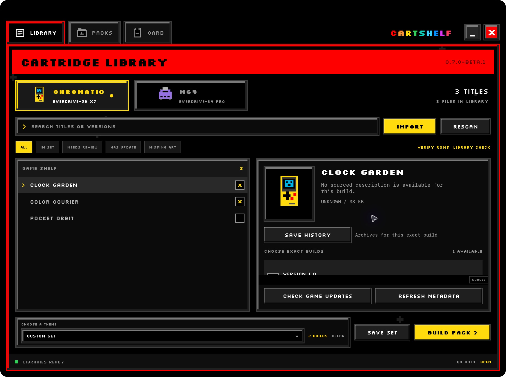
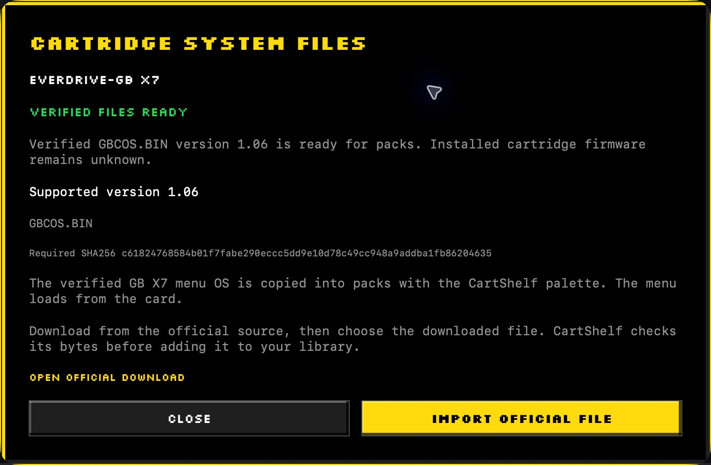
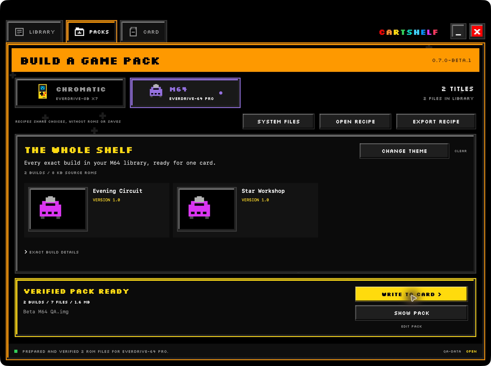

# Build your first CartShelf pack

Use a spare SD card for your first beta test. Card replacement erases the selected card after CartShelf verifies its backup. Keep the library and backups on another drive.

## Install the beta

1. Download `CartShelf-0.7.0-beta.1-macos-arm64.zip` from [the beta release](https://github.com/steph4n-gh/CartShelf/releases/tag/v0.7.0-beta.1).
2. Extract the ZIP.
3. Move `CartShelf.app` to Applications or another normal mounted drive.
4. Open CartShelf on an Apple Silicon Mac running macOS 14 or later.

The release app is Developer ID signed and notarized. The app includes its Python runtime.

## Connect your library

1. Choose **CREATE LIBRARY** for a new collection or **CONNECT LIBRARY** for an existing CartShelf folder.
2. Choose a writable folder outside Git repositories, unpacked source folders, and the app bundle.
3. Select **M64** or **CHROMATIC**.
4. Open **LIBRARY** and choose **IMPORT** to add your game files.

You should see titles and exact builds in the library browser.

Generated-data example. Checkboxes select exact builds. Selecting a title opens its details without adding it to the set. [The library guide](library.md) covers metadata refresh, ROM checks, and recoverable duplicate cleanup.

## Prepare system files

1. Open **PACKS**, then choose **SYSTEM FILES**.
2. Open the official download link for your selected cartridge.
3. Download the supported file from the manufacturer.
4. Choose **IMPORT OFFICIAL FILE** and select that file or a supported official ZIP.
5. Wait for **VERIFIED FILES READY**.

Actual app sheet from the isolated documentation library. **VERIFIED FILES READY** describes the library's cached file. Read [the system-file guide](system-files.md) for supported versions and the difference between an included updater and installed cartridge firmware.

## Build a pack

1. Open **LIBRARY** and select the exact builds you want.
2. Use **SAVE SET** to retain your selection.
3. Choose **BUILD PACK** to open **PACKS**.
4. Give the pack a name and select **SD IMAGE**.
5. Choose **BUILD SD IMAGE**.
6. Wait for **VERIFIED PACK READY**.

This fictional M64 example shows **VERIFIED PACK READY**. The exported image is compact. Direct card installation prepares a FAT32 filesystem using the card's full capacity. Both device pairs receive their [matching menu theme](themes.md).

Use [packs and recipes](packs-and-recipes.md) to reuse saved themes, compare output formats, or share your choices without game files.

## Write a spare card

Fresh-pack replacement in this beta requires one readable FAT source volume. For other layouts, use **BACK UP ONLY** with **WHOLE CARD IMAGE** before preparing a FAT32 card and reviewing the pack again.

1. Insert the spare SD card.
2. Open **CARD** and choose the verified image and the intended removable card.
3. Check the live device identity and capacity.
4. Review game changes, save sources, and the backup method and destination.
5. Choose **BACK UP & REPLACE** after those details match your intention.
6. Keep the card connected through backup, installation, readback checks, and safe ejection.
7. Test the card in the console using [the beta checklist](beta-testing.md).

The [illustrated card review](backup-and-recovery.md#replace-a-pack) shows how game changes, save sources, system files, and the backup destination appear together.

CartShelf protects the physical disks holding the startup system, selected library, and running app. A friendly card name is a label. Always check the live identity before replacement.

## Keep or restore progress

Use [the backup and recovery guide](backup-and-recovery.md) for pack rotation and backup restoration. In **SAVE HISTORY**, verify a complete bundle before choosing it for one reviewed write. You can also export the bundle. Clock and SRAM files stay together.

## Report a problem

Use [the bug-report form](https://github.com/steph4n-gh/CartShelf/issues/new/choose). Include the version, selected device pair, expected result, observed result, and the stage where the operation stopped. Keep personal files and unredacted logs out of the report.

[All guides](README.md) · [Manage your library](library.md) · [Backups and save recovery](backup-and-recovery.md)
