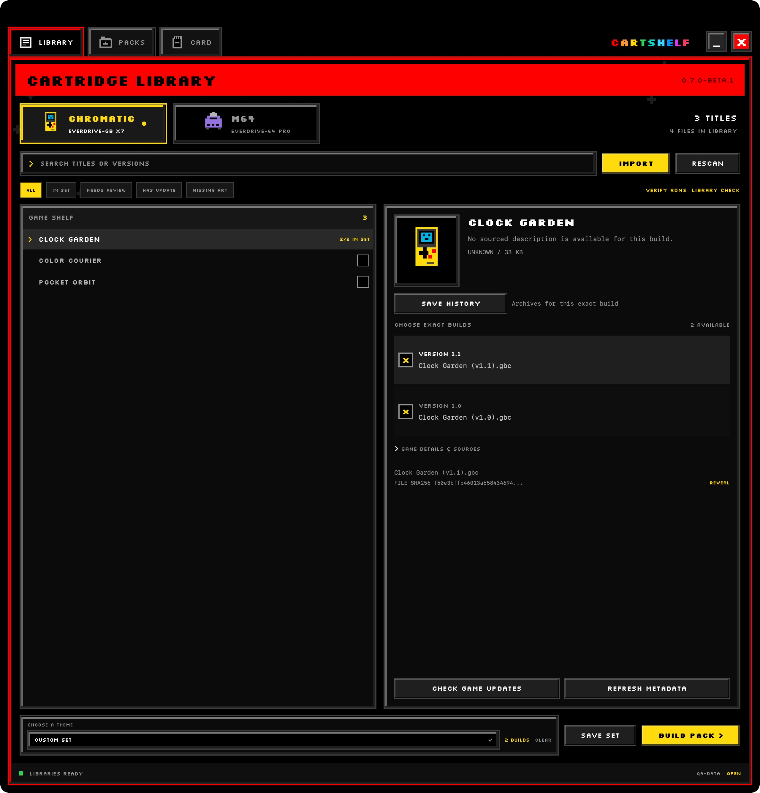

# Manage your library

Connect a writable library folder before importing games. One library can hold both your M64 and Chromatic collections, with its metadata, packs, save history, and backups. The folder can live on an external drive.

## Choose exact game builds

1. Open **LIBRARY** and select **M64** or **CHROMATIC**.
2. Search for a title or version. Use **ALL**, **IN SET**, **NEEDS REVIEW**, **HAS UPDATE**, or **MISSING ART** to narrow the shelf.
3. Select a title to see its available builds.
4. Inspect the version, filename, file size, and hash in the detail panel. In a smaller window, scroll the panel to see all build rows and the hash.
5. Check the builds you want, then choose **SAVE SET** to keep that selection.

This actual app capture uses fictional games. Clock Garden has two generated revisions, each with its own checkbox and content identity. The title has no sourced description, so CartShelf shows that gap rather than inventing metadata.

**CHOOSE A THEME** selects a saved game set. Use **ARCHIVE SET** to retire a saved set without removing its ROMs. Cartridge menu appearance is covered in [the themes guide](themes.md).

Use **IMPORT** to add game files or supported archives, such as ZIP files. To import games from a folder, open the folder in the picker and select the files inside it. Use **RESCAN** after changing files outside CartShelf. If the library drive disconnects, reconnect that folder when prompted.

## Refresh details and artwork

Choose **REFRESH METADATA** for the selected device. Open **GAME DETAILS & SOURCES** to inspect available descriptions, credits, genre, year, and source links.

Refresh uses the network. The first M64 refresh also downloads the community metadata checkout and reference data. Allow that operation to finish before building a pack.

Artwork can identify a title without proving which ROM revision you own. Some homebrew and modified games have no reference match or sourced artwork. Use **MISSING ART** to find those entries. Metadata and downloaded images stay in your library cache.

On M64, this refresh also checks the official firmware directory and caches its newest listed EFU. See [what firmware tracking covers](system-files.md#understand-what-cartshelf-tracks).

## Check ROM integrity

Choose **VERIFY ROMS** to read the files again and inspect the result.

| Result | What it tells you |
| --- | --- |
| Reference match | The file matches available reference data. This does not establish console compatibility. |
| Unlisted build | The build has no reference match. Homebrew and modified games can be valid and unlisted. |
| Needs review | Inspect the reported checksum or format concern before using the file. |
| Changed file | The bytes differ from the recorded library identity. Rescan and investigate the change. |
| Invalid file | The verifier found a format or structural problem. Read its reason. |

A filename's version label and an internal checksum are evidence with limits. Neither is a gameplay test. CartShelf leaves questionable files available for review.

## Quarantine duplicate copies

1. Choose **LIBRARY CHECK**.
2. Review the confirmed duplicates and the copy marked **KEEP**.
3. Choose **QUARANTINE DUPLICATES** to move the extra copies into library quarantine.
4. To undo a batch, return to **LIBRARY CHECK** and choose its **RESTORE** action.

Cleanup preserves distinct builds. It does not delete every similarly named file or automatically discard games that need review.

## Check Chromatic game release notes

On the Chromatic shelf, choose **CHECK GAME UPDATES**. CartShelf compares recognized games with public ModRetro release notes and shows the listed version, date, and changes. Use **HAS UPDATE** to find entries with a newer listed release.

The comparison uses the local filename's version label. It does not verify the ROM's version, establish save compatibility, download an updated game, or patch your file. Game release notes are separate from [cartridge system files](system-files.md).

Continue with [packs and recipes](packs-and-recipes.md) or [save history](backup-and-recovery.md#choose-an-earlier-save).
