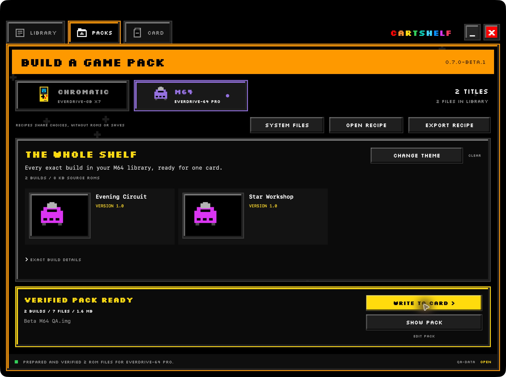
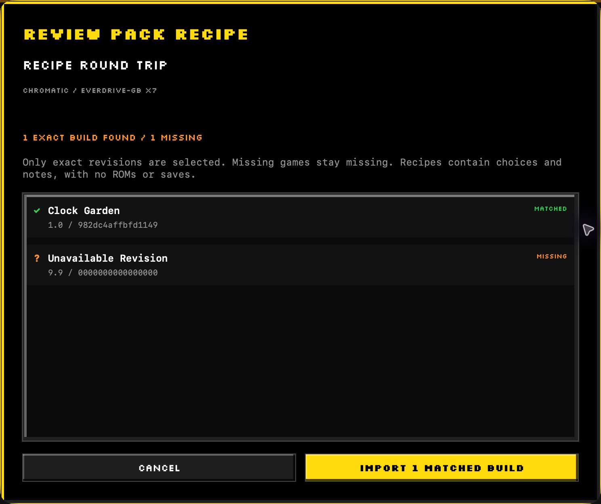

# Build packs and share recipes

Make a racing night, a puzzle afternoon, or a homebrew discovery set from games already in your library. Saved sets keep exact build choices so you can return to the same versions later.

## Build a themed game set

1. In **LIBRARY**, check the exact builds you want.
2. Choose **SAVE SET** and name your selection.
3. Open **PACKS**.
4. Use **CHANGE THEME** to choose a saved game set, or keep your current custom selection.
5. Review the games and expand **EXACT BUILD DETAILS** to inspect the selected revisions.
6. Enter a pack name and choose an output.
7. Choose **BUILD SD IMAGE** or **PREPARE PACK**, according to the output.

The generated-data example has two M64 builds. **VERIFIED PACK READY** gives you **SHOW PACK** and, for an image, **WRITE TO CARD >**.

Here, **CHANGE THEME** chooses games. Packs also receive the matching [CartShelf cartridge menu theme](themes.md).

## Choose an output

| Output | Use it for |
| --- | --- |
| **SD IMAGE** | A verified compact FAT32 image for CartShelf's Card workflow or another image writer. |
| **ZIP** | An archive of the prepared card folder and its manifest. |
| **FOLDER** | An unpacked cartridge layout for inspection or manual copying. |

Check **SYSTEM FILES** before preparing a full-card replacement. A game-only folder is not a complete bootable card layout.

The exported image uses a compact partition. CartShelf's direct installation prepares the card's full capacity and restores matching saves. Another image writer can reproduce the compact partition size as-is.

To reuse an earlier export, open **PREPARED IMAGES** and choose **CHECK & USE IMAGE**. This checks the current file before passing it to Card.

## Share a recipe

1. Select the game set in **PACKS**.
2. Choose **EXPORT RECIPE**.
3. Save the recipe file and inspect it before sharing.

A recipe carries the set's name, notes, titles, version labels, and exact content hashes. It contains no ROMs, saves, artwork, firmware, or local file paths. The recipient supplies their own game files.

## Open someone else's recipe

1. Choose **OPEN RECIPE** in **PACKS**.
2. Select the recipe file.
3. Review the exact matches and missing builds.
4. Choose **IMPORT N MATCHED BUILDS** to create a set from the matches.

This actual app capture uses a generated recipe. CartShelf leaves the unavailable revision missing rather than selecting another version of that game. Importing the recipe does not download games.

When the pack is ready, follow [the first card-write steps](getting-started.md#write-a-spare-card). For later rotations, read [how progress moves between packs](backup-and-recovery.md).
