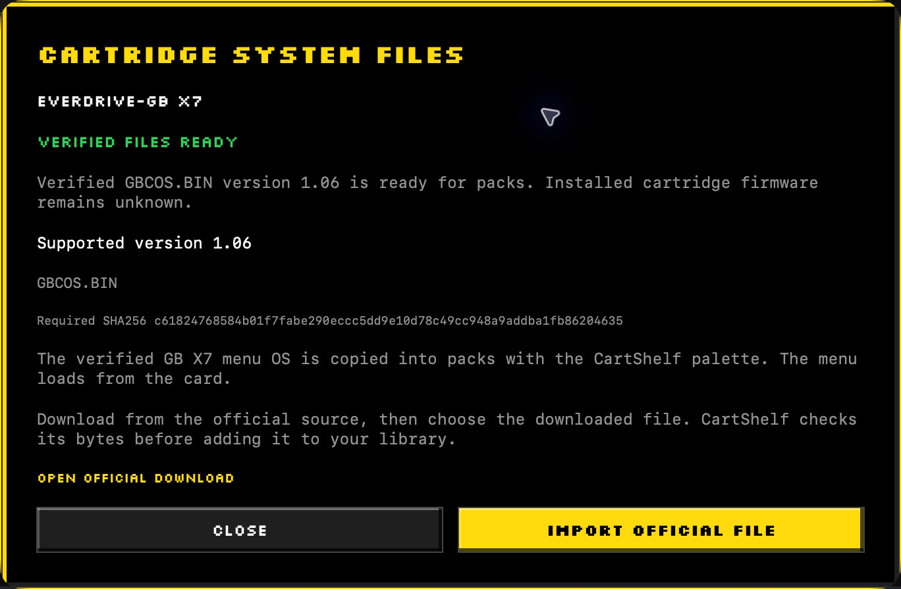
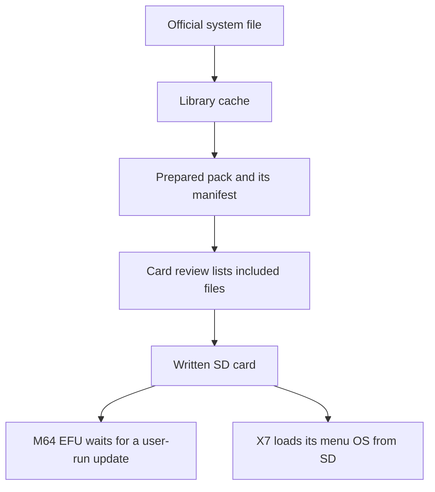

# Prepare system files and track firmware

Use **PACKS > SYSTEM FILES** to check the selected cartridge's supported import, verified cache status, required SHA-256, and official download link. The source repository and app contain no vendor firmware or menu OS binaries.

Actual app capture from an isolated documentation library. The checksum identifies the cached stock file. The sheet explicitly leaves installed cartridge firmware unknown.

## Import the supported official file

1. Select **M64** or **CHROMATIC** and open **PACKS > SYSTEM FILES**.
2. Choose **OPEN OFFICIAL DOWNLOAD**.
3. Download the supported file from the manufacturer.
4. Choose **IMPORT OFFICIAL FILE** and select that file or a supported official ZIP.
5. Wait for **VERIFIED FILES READY** before preparing the pack.

The importer checks the exact stock size and SHA-256 before caching the file and its source receipt in your library. Unknown or changed bytes need review.

| Device pair | Supported importer in 0.7.0-beta.1 | Use in the pack |
| --- | --- | --- |
| M64 and EverDrive-64 PRO | EFU 26.1014 | An updater under `Firmware`. You run the update on the cartridge when needed. |
| Chromatic and EverDrive-GB X7 | Menu OS 1.06 | A separately themed `GBCSYS/GBCOS.BIN` that the cartridge loads from SD. |

These are the beta's pinned import identities. They are not a promise that no newer manufacturer release exists.

## Understand what CartShelf tracks

| Place in CartShelf | What it tells you |
| --- | --- |
| **SYSTEM FILES** | The supported offline import, required checksum, and readiness of that library cache. |
| M64 **REFRESH METADATA** | Also checks the official PRO firmware directory and caches its newest listed EFU. M64 packs select the highest cached matching EFU version. |
| Card replacement review | The system files actually included in that prepared pack. Check this when an EFU newer than the pinned import is cached. |
| Installed cartridge firmware | Unknown. CartShelf does not query the installed version or flash the cartridge. |

An existing exported pack keeps the files it was built with. Refresh the library and build a new pack to include changed cached inputs.

The cache and pack record file provenance. The beta has no firmware-change-history screen or universal firmware update checker. For changes between manufacturer releases, read the official notes linked below. [Chromatic game release notes](library.md#check-chromatic-game-release-notes) are a separate check.

## EverDrive-64 PRO files

Use the [official PRO-series support directory](https://krikzz.com/pub/support/everdrive-64/pro-series/) for the manual and tools. Its [firmware directory](https://krikzz.com/pub/support/everdrive-64/pro-series/firmware/) contains EFU downloads and release notes.

The library caches EFUs under `cache/firmware`. Copying an EFU to a card does not update the cartridge. Follow the manufacturer's update procedure on the cartridge when an update is needed.

## EverDrive-GB X7 files

Use the [official X-series OS directory](https://krikzz.com/pub/support/everdrive-gb/x-series/OS/) and its [OS change list](https://krikzz.com/pub/support/everdrive-gb/x-series/OS/changelist.txt).

The stock OS cache is `cache/firmware/gb-x7/GBCSYS/GBCOS.BIN`, with a source receipt alongside it. Pack preparation applies [the fixed CartShelf-GB palette](themes.md#chromatic-with-everdrive-gb-x7) to an independent copy. Unknown revisions are rejected rather than patched at guessed offsets.

For X7 migration, finish saving, return to its menu, and launch another title before powering off. This is a conservative precaution. The public manufacturer information used during development does not establish the exact SRAM-to-SD flush timing.

## Check the pack before replacement

Read the pack's system-file status. A game-only folder export is distinct from a complete bootable layout. Do not erase a working system layout to install an incomplete pack.

[All guides](README.md) · [Menu themes](themes.md) · [First card write](getting-started.md#write-a-spare-card)
