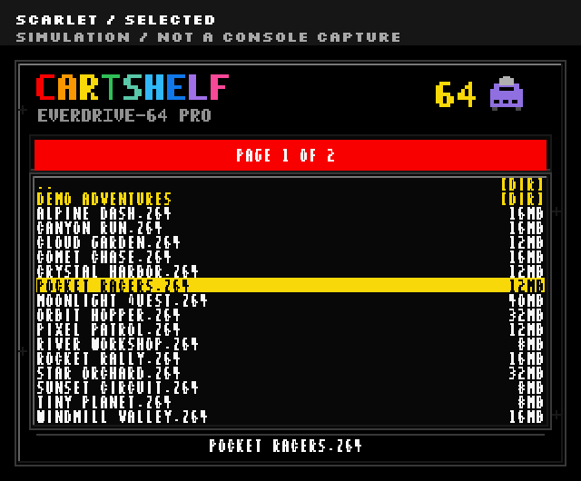
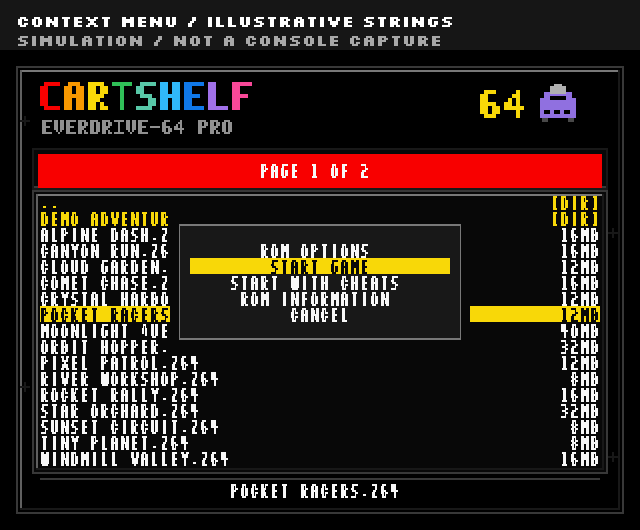
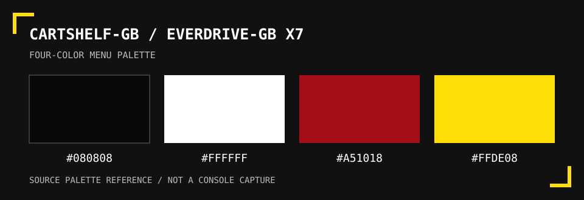

# CartShelf themes

CartShelf carries its pixel style onto both supported cartridges. M64 packs include the CartShelf-64 menu artwork and font. Chromatic packs apply the CartShelf-GB colors to the supported EverDrive-GB X7 menu OS.

These menu themes are built into pack preparation. In the app, **CHOOSE A THEME** and **CHANGE THEME** choose a themed collection of games. They do not open an appearance editor.

## M64 with EverDrive-64 PRO

Authored menu simulation, not a console capture. The public theme uses original geometry and an OFL Silkscreen font atlas. Physical qualification of this public atlas remains open.

Normal M64 packs include the complete theme at `Themes/CartShelf-64.bgr` and stage it as the startup theme at `ed64/sysdata/theme.bgr`. A wallpaper-only PNG is included as an alternative asset. The menu uses a black background, scarlet bars, yellow selection, and CartShelf's multicolor lettering.

The popup is also an authored simulation with fictional entries. Preview colors and geometry do not establish physical cartridge behavior.

## Chromatic with EverDrive-GB X7

Source palette reference, not a console capture. Handheld display colors can differ from these browser swatches.

The source colors are charcoal `#080808`, white `#FFFFFF`, scarlet `#A51018`, and yellow `#FFDE08`.

CartShelf-GB changes four menu palette entries in an exact verified OS 1.06 copy. The library keeps its stock `GBCOS.BIN` unchanged. Pack preparation themes a separate copy for `GBCSYS/GBCOS.BIN` and verifies the output.

This palette change keeps the X7's existing menu layout and font. It does not add M64-style wallpaper or box-art browsing. Import the supported official OS through [SYSTEM FILES](system-files.md) before building a complete Chromatic card.

## Make your own game theme

Select exact builds in **LIBRARY**, choose **SAVE SET**, and give the set a name. Return to that set through **CHANGE THEME** in **PACKS**. A theme could be a genre, a publisher, a weekend selection, or a mix of favorites. [Packs and recipes](packs-and-recipes.md) explains how to build and share it.

## Work on cartridge artwork

The beta has no graphical palette editor, arbitrary menu-theme importer, or in-app appearance-variant selector.

For source contributions, start with [the CartShelf-64 theme builder](../themes/CartShelf-64/README.md) or [the fixed GB palette patcher](../themes/CartShelf-GB/apply_theme.py). The app verifies pinned theme assets, so changed output needs updated checks and physical qualification. Alternate N64 preview designs in the source are developer experiments, not choices in the current app.
