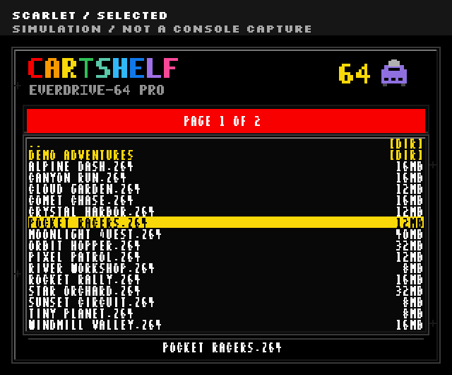

# Build the CartShelf-64 theme



Authored simulation, not a console capture. For automatic pack styling and the matching X7 palette, read [the user-facing themes guide](../../docs/themes.md).

Run these commands from the source repository with Pillow installed.

```sh
python3 -B themes/CartShelf-64/build_theme.py
python3 -B themes/CartShelf-64/verify_theme.py
```

The builder creates an original menu atlas, the complete `dist/CartShelf-64.bgr` theme, a wallpaper-only PNG, and labelled simulations. Its optional install ZIP goes to ignored `build/themes/CartShelf-64.zip`, outside the source asset tree. `VERIFICATION.json` records source and output hashes. `INDEPENDENT_CHECK.json` records format, pixel, and reproducibility checks.

The independent verifier parses the BGR header and its aligned sections. It checks a 160 by 64 indexed font atlas, a 640 by 240 indexed wallpaper, menu positions, clipping, popup cells, exact branding pixels, and a repeated build.

The theme uses ten-by-eight-pixel character cells. The first 128 character positions cover geometric controls and ASCII. Printable text comes from OFL Silkscreen outlines. Geometry remains separate from console capture or physical compatibility evidence.

The app adds the complete theme as `Themes/CartShelf-64.bgr` and the startup theme as `ed64/sysdata/theme.bgr`. The PNG is a wallpaper-only alternative. The app verifies pinned asset hashes before staging.

This public replacement atlas has not been tested on a physical cartridge. The previews are simulations with authored fictional game names. See [asset licenses](LICENSE-ASSETS.md) and the included [OFL notice](source/OFL.txt).
